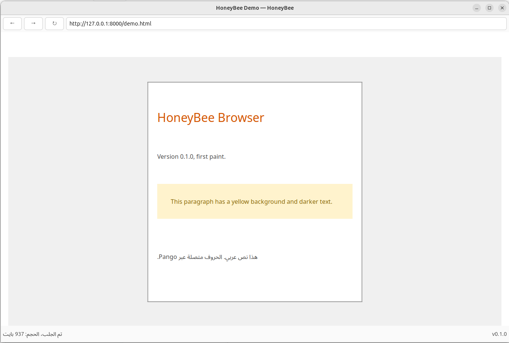

# Current State of HoneyBee

**Version:** v0.1.0 (first paint)
**Updated:** 2026-10-20

This page describes what HoneyBee renders today, what it does not, and why. If a real page looks wrong compared to Firefox, this page tells you whether it is a bug or a known gap.

## What HoneyBee looks like today

Loading [`docs/demo.html`](demo.html) through the full pipeline:



The demo page exercises every CSS feature we support. It renders exactly as its CSS specifies -- parse, cascade, layout, paint, and Arabic letter-shaping all working end to end.

To reproduce: clone the repo, build, then load `docs/demo.html` in the browser (via `file://` if your curl supports it, or by serving the `docs/` directory over HTTP).

## What renders correctly

| Feature | Landed in |
|---|---|
| HTML parsing (via lexbor) | #91, #93 |
| Owned DOM tree (no lexbor pointers escape) | #98 |
| CSS selectors: type, class, id, attribute; all four combinators | #101 |
| Stylesheet parsing: declarations, `!important`, block comments | #104 |
| Box shorthands: `margin: 10px 20px` expands to four longhands | #113 |
| Length units: `px`, `em`, `rem`, `%`, `auto` (horizontal margins) | #116 |
| Cascade: importance > specificity > source order | #107 |
| Inheritance: color, font-family, font-style, font-weight, line-height, visibility | #107 |
| Block-flow layout: box model, width fills parent, height derived | #110 |
| Cairo paint: background-color, border, text | #110 |
| Arabic text with correct letter joining (via Pango) | #110 |
| UA stylesheet: body margin, heading sizes, paragraph gaps | #121 |
| Text wrapping at word boundaries + whitespace collapsing | #125 |
| Inline formatting (`<span>`, `<a>`, `<em>` flow with text) | #129 |
| `display` property (block, inline; other values deferred) | #129 |
| `dir` attribute (`ltr`, `rtl`, `auto`, inheritance) | #129 |
| Per-fragment style (inline element colors) | #129 |

## What does NOT render yet

| Missing | Reason | Planned |
|---|---|---|
| Pseudo-classes (`:hover`, `:link`, `:visited`) | not in selector parser | future ADR |
| Pseudo-elements (`::before`, `::after`) | not in selector parser | future ADR |
| `@media` queries | at-rules skipped by parser | future ADR |
| `border-radius`, `box-shadow`, `text-decoration` | not in paint | future ADR |
| `font` shorthand, `max-width`, `text-align` | not implemented | future ADR |
| `background` shorthand | only `background-color` supported | future ADR |
| `float`, `position` | layout is block-only | future ADR |
| `calc()`, `var()`, CSS-wide keywords | simple value parser | future ADR |
| Viewport units (`vw`, `vh`) | not in length parser | future ADR |
| `light-dark()`, `color-scheme` | not implemented | future ADR |

## Why example.com looks different from Firefox

Example.com is often used as a smoke test. As of the v0.1.0 date, its stylesheet uses almost exclusively properties HoneyBee does not implement, so it renders as a text dump:

```css
html { color-scheme: light dark; background: light-dark(#eee, #222) }
body { font: 16px/1.6 system-ui, sans-serif; max-width: 26em;
       margin: auto; padding: 25vh 2em 2em; text-align: center }
```

Of the ~10 properties here, HoneyBee renders **two**: `margin: auto` (which correctly resolves to 0 when the container is full-width, so no centering effect) and `padding: 2em` on the sides. Everything else is a documented gap:

| Property used | HoneyBee's behavior | Reason |
|---|---|---|
| `color-scheme` | ignored | not implemented |
| `background: light-dark(...)` | ignored | shorthand + `light-dark()` not implemented |
| `font: 16px/1.6 system-ui` | ignored | `font` shorthand not implemented |
| `max-width: 26em` | ignored | `max-width` not implemented |
| `margin: auto` | 0 (correct -- no slack) | works, but no effect without `max-width` |
| `padding: 25vh 2em 2em` | partial -- `25vh` becomes 0 | `vh` not implemented; `2em` works |
| `text-align: center` | ignored | not implemented |

After ADR-014, the paragraph also gains UA `p { margin: 1em 0 }`
-- visible as about 16px of whitespace above and below the
text. The author `body { margin: auto }` correctly overrides UA
`body { margin: 8px }`; that override is the origin-aware
cascade working as designed.

**This is not a bug.** It is a page that uses CSS features HoneyBee does not support yet. When those features land via future ADRs, example.com will render closer to Firefox.

The [demo page](demo.html) is HoneyBee's honest smoke test. It uses only supported properties, so it renders exactly as its CSS specifies.

## Text direction (resolved in ADR-016)

Direction is determined by the `dir` attribute on an element or
its nearest ancestor that sets one. Resolution order:

- `dir="ltr"` -> LTR (lines left-aligned)
- `dir="rtl"` -> RTL (lines right-aligned)
- `dir="auto"` -> first-strong-character heuristic (opt-in)
- missing -> inherit from parent, default LTR at `<html>`

This matches HTML spec behavior: paragraphs without an explicit
`dir` inherit LTR and render left-aligned. Arabic pages use
`<html dir="rtl">` (the standard pattern) to render right-aligned
throughout.

**Note (superseded)**: before ADR-016, a first-strong heuristic
was applied unconditionally, causing mixed-direction paragraphs
to right-align even without a `dir` attribute. That divergence
from Firefox is resolved by making the heuristic opt-in via
`dir="auto"`.

## How to report a visual bug

If a page looks wrong and the specific difference is **not** in the "does not render" table above:

1. Open an issue with the URL
2. Attach a HoneyBee screenshot
3. Attach a Firefox (or other browser) screenshot for comparison
4. State the specific CSS rule that should apply but is ignored

If the difference **is** in the table, it is a known gap -- no need to report. Watch `docs/decisions/` for ADRs that close these gaps.
